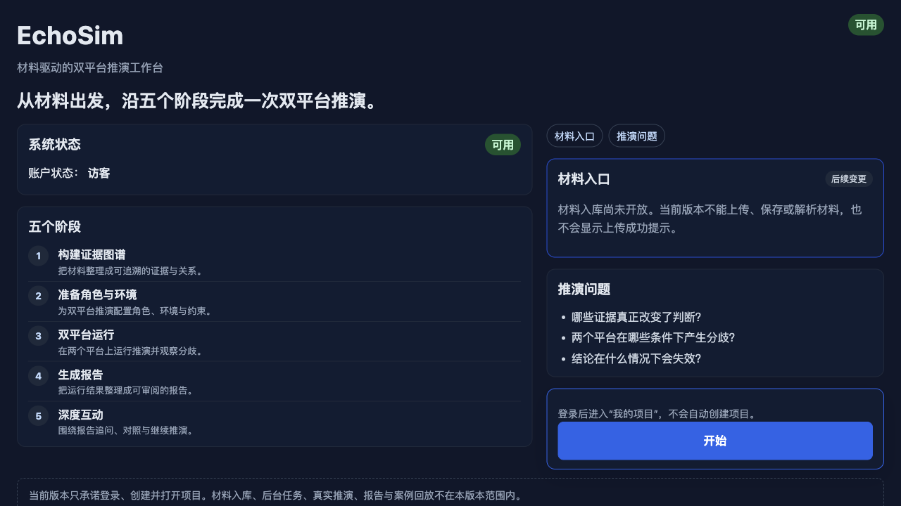
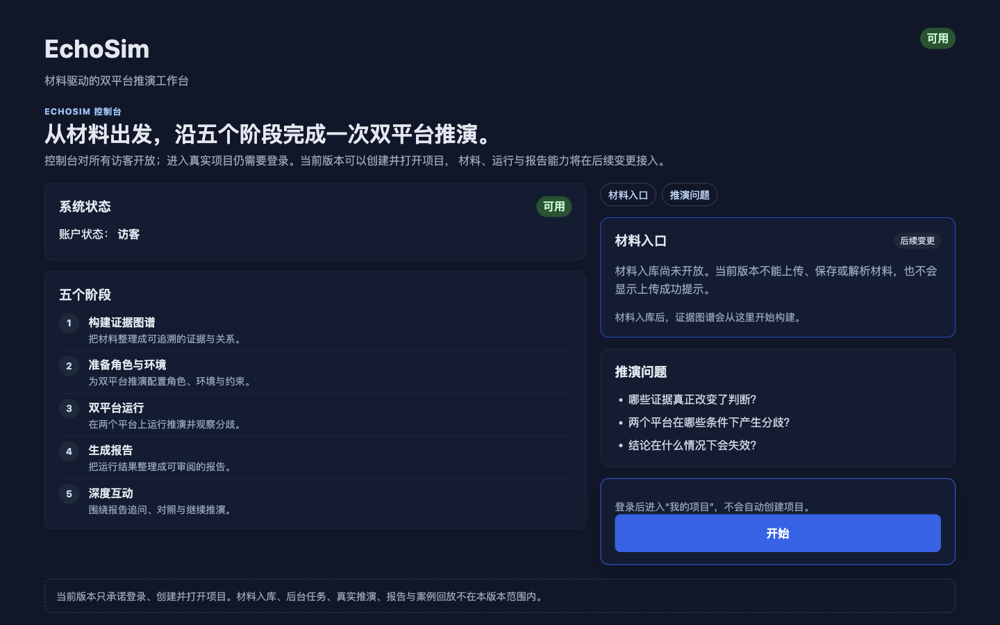

# 人工验收记录

- 被测 SHA：`41f91c98b5d279d9572257d7d8b3b811323bda14`
- 短 SHA：`41f91c9`
- 分支：`change/2026-11-21-build-workbench-shell`
- 验收日期：`2026-11-21`
- 执行者：Pi（Chromium 走查）、Codex（桌面 Chrome 补验）
- 验收人：`sutu1023（项目作者，已审阅签收）`
- 环境：Pi 使用 Chromium headless shell 1194 对 Docker Compose 本地环境做实际浏览器走查；Codex 使用 macOS 26.4、桌面 Chrome 157.0.8103.80，独立普通配置并关闭会话恢复；后端 Python 3.11，数据库 PostgreSQL 16。

> 说明：HTTP 200 加 `EchoSim` HTML 只证明 SPA 入口可达。本记录中的布局、语言、浏览器后退、加载态、空态、503 重试与关闭重开浏览器结论均来自实际浏览器执行。

## 验收场景

| 场景 | 预期 | 实际 | 结论 |
| --- | --- | --- | --- |
| 控制台 1280×720 | 左右栏、五阶段、材料/问题与“开始”按钮可见可操作 | Pi 与 Codex 均确认五阶段完整、主按钮完整落在首屏、无横向溢出；见下方截图 | 通过 |
| 控制台 1440×900 | 同一内容完整显示，无遮挡或裁切 | Pi 与 Codex 均确认完整显示、无横向溢出；见下方截图 | 通过 |
| 五阶段顺序 | 构建证据图谱 → 准备角色与环境 → 双平台运行 → 生成报告 → 深度互动 | 两种尺寸下均按固定顺序显示五个阶段 | 通过 |
| “开始”三态 | 访客登录；无项目进入创建；有项目进入最近项目第一阶段 | 访客 `/login?next=/projects`；B 无项目进入 `/projects?intent=create` 且焦点在 `project-name`；A 有项目进入 `evidence-graph` | 通过 |
| 登录落点与返回 | 无 `next` 进入 `/projects`；带 `next` 登录后回完整原地址 | 默认登录进入 `/projects`；匿名访问非法阶段后登录回到完整工作台地址 | 通过 |
| 工作台阶段导航与后退 | 报告 `graph/en` → 深度互动仍为 `graph/en`；刷新保持；后退回报告 `graph/en` | 地址依次为 `interaction?layout=graph&lang=en`、刷新后不变、后退回 `report?layout=graph&lang=en` | 通过 |
| 中英文三种布局 | 中英文下「图谱」「双栏」「工作台」区域正确，项目与阶段不丢失 | 六种组合均通过，`layout`/`lang` 查询参数保持 | 通过 |
| 返回控制台再后退 | 返回 `/` 后浏览器后退回到离开前完整工作台地址 | 回到同一项目的 `report?layout=workbench&lang=zh` | 通过 |
| 缺少材料 / 缺少前置 | 显示“还没有材料”或“缺少前置步骤”，并提供继续入口 | 第一阶段显示“还没有材料”；报告阶段显示“缺少前置步骤”；继续链接保留查询参数 | 通过 |
| 加载态与空态 | 加载中不误报空数据；外壳就绪可与阶段空态共存 | 延迟项目请求时显示 `Loading project…` 且无空数据；随后项目名、阶段高亮、工具条与布局可操作 | 通过 |
| 访问边界 | 匿名先登录；他人/不存在项目相同 404；仅所有者看到非法阶段 | 匿名跳登录并保留 `next`；B 看到 `Project not found`；A 看到“阶段不存在”/`Stage not found` 和五个有效阶段入口 | 通过 |
| 会话 503、健康 200 | 系统状态仍“可用”；账户“暂时无法确认”；保留 Cookie 并可重试 | 健康保持“可用”，按钮禁用；重试恢复“已登录”，原 Cookie 保留 | 通过 |
| 项目列表 503、健康 200 | 系统状态仍“可用”；“开始”进入 `/projects` 由项目页重试 | 项目页显示 503，重试后列表恢复 | 通过 |
| 健康降级与恢复 | 停库显示“降级”，控制台仍可读；恢复后回到“可用” | 停库时五阶段仍可读；恢复后健康检查 200 | 通过 |
| 工作台 503 重试 | 停库显示服务不可用并保留 Cookie；恢复后重试回原阶段 | 重试回到同一项目 `report?layout=graph&lang=en` | 通过 |
| Change 01 故障恢复 | `/health` 200 → 503 → 200，`/livez` 200，应用容器身份不变 | Codex 桌面 Chrome 复验通过；容器 ID/PID/启动时间/重启次数一致 | 通过 |
| Change 02 完全退出重开 | 关闭并重开浏览器后无会话 Cookie，需重新登录 | Codex 关闭独立 Chrome 进程后重开，首请求 401，登录页保留完整 `next` | 通过 |
| Change 02 退出撤销 | 退出后旧会话请求私有接口返回 401 | 退出前 200，退出接口 204，浏览器 Cookie 清除，旧会话再次请求 401 | 通过 |
| Change 02 项目隔离 | B 的列表/历史不含 A 项目；他人与不存在项目表现相同 | B 列表与历史为空；详情与工作台的他人/不存在项目均 404，响应体逐字节相同、页面提示相同 | 通过 |

### 控制台截图

以下截图均为公开访客控制台，不含账户、项目或令牌信息。

## 可重复性

- 第一次 `make verify`：退出码 `0`，`result=passed`，`dirty=false`，20/20 场景，报告 `runtime/verify/run-20261120T183615Z.json`（`started_at=2026-11-20T18:36:06Z`）
- 第二次 `make verify`：退出码 `0`，`result=passed`，`dirty=false`，20/20 场景，报告 `runtime/verify/run-20261120T183632Z.json`（`started_at=2026-11-20T18:36:22Z`）
- 两次 `tested_sha` 均为 `41f91c98b5d279d9572257d7d8b3b811323bda14`
- 停库到 `/health` 返回 503 的实测耗时为 `0.003s`
- 结束时状态：`/health` 返回 200，数据库 running，应用与数据库容器 healthy

## CI

### 分支 push 运行

- 运行链接：<https://github.com/sutu1023/echosim/actions/runs/44796058709>
- 触发 SHA / 分支 SHA：`41f91c98b5d279d9572257d7d8b3b811323bda14`
- 运行结论：`success`
- 产物名称：`verify-report-41f91c98b5d279d9572257d7d8b3b811323bda14`
- 产物中 `tested_sha` / `dirty` / `result` / 场景数：`41f91c98b5d279d9572257d7d8b3b811323bda14` / `false` / `passed` / `20`

### PR 运行

- 运行链接：<https://github.com/sutu1023/echosim/actions/runs/44796121513>
- 触发方式：PR #3（`pull_request` 事件）；实际检出并测试 PR 测试合并提交
- PR 测试合并 SHA：`18cf89d296000b9cce525e1bda4bed0455858a36`
- 运行结论：`success`
- 产物名称：`verify-report-18cf89d296000b9cce525e1bda4bed0455858a36`
- 产物中 `tested_sha` / `dirty` / `result` / 场景数：`18cf89d296000b9cce525e1bda4bed0455858a36` / `false` / `passed` / `20`

## 证据

- 本地报告：`runtime/verify/last-run.json`（`tested_sha=41f91c98b5d279d9572257d7d8b3b811323bda14`，`dirty=false`）
- 历史报告：`runtime/verify/run-20261120T183615Z.json`、`runtime/verify/run-20261120T183632Z.json`
- Pi 浏览器汇总：`runtime/acceptance/2026-11-21-build-workbench-shell/summary.json`（20 张原始截图）
- Codex 补验记录：`runtime/acceptance/2026-11-21-build-workbench-shell/codex-6.4/复核记录.md`、`browser.json`、`candidate.json`
- 分支 CI 产物：`verify-report-41f91c98b5d279d9572257d7d8b3b811323bda14`（运行 `44796058709`）
- PR CI 产物：`verify-report-18cf89d296000b9cce525e1bda4bed0455858a36`（运行 `44796121513`）
- PR：<https://github.com/sutu1023/echosim/pull/3>
- 脱敏截图：`docs/acceptance/assets/2026-11-21-41f91c9/console-1280x720.png`、`docs/acceptance/assets/2026-11-21-41f91c9/console-1440x900.png`

## 结论

通过。Change 03 的公开控制台、三态“开始”、工作台深链接、三种布局、中英文切换、查询参数保持、阶段进入条件与四态错误边界均在 Chromium 与桌面 Chrome 中符合规格；Change 01/02 的健康故障恢复、容器身份、完全退出重开、退出撤销和项目隔离回归通过。同一候选提交的两次本地验收、分支 CI 与 PR CI 均为 20/20 通过。

验收人签名：`sutu1023`（`2026-11-21`，已审阅签收）
